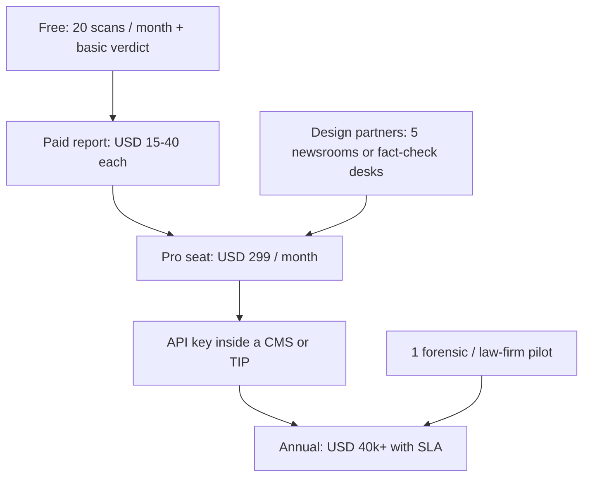

# TruthLens

**Forensic-grade verification for AI-generated images, audio, and video.**

TruthLens is a multimodal media-authenticity platform. It does not return a naked probability. It returns a verdict, a calibrated confidence, the evidence that produced it, and an integrity trail a journalist, investigator, or counsel can defend.

| | |
|---|---|
| Stage | Prototype → productized verification platform |
| Stack | TruthLens frontend · DeepSafe API (FastAPI, LangGraph, forensic nodes, MongoDB) |
| Category | Synthetic-media detection + provenance |
| Buyer | Newsrooms, forensic teams, legal/compliance, platforms, BFSI identity teams |
| Wedge | Explainable, hybrid forensic reports — not another black-box score |

---

## 1. The problem, in numbers

| Signal | Figure | Source |
|---|---|---|
| Deepfake detection market, 2025 | **USD 0.71–0.92 billion** | Meticulous Research USD 0.71B; SNS Insider USD 918.6M |
| Same market, 2026 | **~USD 0.99–1.19 billion** | Meticulous USD 0.99B; SNS USD 1.19B |
| 2035 forecast (high case) | **USD 12.14 billion** | SNS Insider, 29.5% CAGR 2026–2035 |
| 2036 forecast (base case) | **USD 9.44 billion** | Meticulous Research, 25.3% CAGR 2026–2036 |
| Recorded deepfake fraud losses | **USD 1.56 billion** cumulative; **>USD 1 billion in 2025 alone** | Surfshark dataset, reported Nov 2025 |
| Prior baseline | USD 130M (2019–2023) → ~USD 400M (2024) | Same dataset |
| Voice deepfake fraud attempts | **+1,300% in 2024** (1/month → 7/day) across 1.2B calls | Pindrop 2025 Voice Intelligence Report |
| Organizations hit by at least one deepfake incident | **84%** | IRONSCALES 2026 Cybersecurity Threat Report |
| Average loss among victims | **~USD 280k (2025), ~USD 225k (2026)** | IRONSCALES 2026 |
| Orgs investing in deepfake defense | **48% in 2026, up from 37%; 63% spent nothing the year before** | IRONSCALES 2026 |
| Document deepfakes | Projected **~40×** rise in 2026 vs 2025 (attempts) | Shufti Deepfake Identity Fraud Index 2026 |
| Single-incident scale | **EUR 95 million** wired after an AI executive impersonation (Fideuram / Intesa, 2026) | Public reporting, Oct 2026 |
| Software / API share of detection spend | **~74%** of 2025 market | SNS Insider |
| Video share of modality | **~39%**; audio is the fastest-growing modality (**~34.6% CAGR**) | SNS Insider |
| Services growth | Forensic / integration / managed detection **~33.8% CAGR** | SNS Insider |
| Cloud deployment | **~71%** of 2025 deployments | SNS Insider |
| Geography | North America largest; **Asia-Pacific fastest** | Meticulous, SNS |
| US federal judges who had seen a deepfake evidence challenge (survey, early 2026) | **15 of 931** | US Judicial Conference / FJC |
| OpenAI + Meta to that same panel (Oct 2026) | Detection will not stay reliable as generators improve | Reuters, 15 Oct 2026 |

Analyst houses do not agree on the exact dollar figure. They agree on the shape: a sub-billion category in 2025, a **9–13×** expansion by the mid-2030s, and a fraud loss curve that already jumped an order of magnitude in a single year.

The product gap is narrower than the market gap. Most paid tools return a score. Courts, news desks, and fraud teams need a **file they can put in front of a human who will be cross-examined**.

---

## 2. What TruthLens sells

One job: take a media object and produce a **verification package**.

| Output | Why a buyer pays |
|---|---|
| Verdict | `LIKELY AUTHENTIC` / `LIKELY SYNTHETIC OR MANIPULATED` / `INCONCLUSIVE` |
| Calibrated confidence | Includes disagreement between models, not a single overconfident number |
| Evidence list | Metadata anomalies, visual/audio artifacts, model votes, conflicting signals |
| Integrity block | SHA-256 of the bytes, analysis id, timestamps, model names and versions |
| Provenance read | Existing C2PA Content Credentials, kept separate from our independent analysis |
| Export | PDF / JSON report a desk editor or counsel can file |

C2PA answers “who signed this file.” Detection answers “do the pixels and samples look synthetic.” Neither is sufficient alone. TruthLens is built to show both, and to say when they conflict.

---

## 3. Architecture

| Layer | Responsibility | Current base |
|---|---|---|
| Client | Intake, progress, case library, report UI | [TruthLens](https://github.com/Sachin-Tiwarii/TruthLens) |
| API | Auth, upload, job status, report fetch | [DeepSafe](https://github.com/siddharthksah/DeepSafe), FastAPI |
| Orchestration | Route by media type; skip irrelevant detectors; fuse conflicts | LangGraph |
| Detectors | Vision models, audio fingerprints, frame sampling | Pluggable nodes |
| Forensics | EXIF/container metadata, hashing, simple signal checks | ExifTool, OpenCV, Pillow, NumPy |
| Store | Jobs, hashes, model versions, report JSON | MongoDB |
| Later | C2PA verify/sign, browser capture, on-prem worker | Roadmap, not day-one scope |

Design rule: **the client never invents a verdict.** It renders the report the API already computed. Adding a detector means adding a node, not rewriting the UI.

---

## 4. Workflow

| Stage | What is measured | Failure mode we refuse to hide |
|---|---|---|
| 1. Ingest | Hash, type, duration/resolution | Unsupported or truncated file → hard fail, no score |
| 2. Metadata | EXIF, container, C2PA if present | Stripped metadata is a signal, not “clean” |
| 3. Detectors | Model-specific artifacts | A single model vote is not a verdict |
| 4. Fusion | Agreement, conflict, coverage | Conflict above threshold → `INCONCLUSIVE` |
| 5. Seal | Hash of input, hash of report, versions | Report without versions is not exportable |

---

## 5. Market and where the money sits

Use **USD 0.9 billion (2025) → USD 1.0–1.2 billion (2026) → USD 9–12 billion (2035–36)** as the planning band. Do not pitch a single CAGR as fact. The defensible statement is **25–30% CAGR** across the two most-cited 2026 forecasts.

| Segment (2025 mix, SNS) | Share | What they buy | TruthLens fit |
|---|---|---|---|
| Software / API | 73.6% | Per-scan or committed volume | Core. Self-serve API + annual commit |
| Services | rest, 33.8% CAGR | Integration, managed forensics | Year-2 margin, not year-1 headcount |
| Video | 39.2% | Frame + temporal checks | In scope |
| Audio | fastest, ~34.6% CAGR | Voice-clone screening | In scope; price higher per minute |
| Identity / KYC | 29.8% of application | Liveness-adjacent checks | Partner, do not rebuild a KYC suite |
| Media and elections | fastest application, ~36% CAGR | Desk tools + evidence packs | Beachhead |

**Beachhead math (illustrative, not a forecast).**

| Motion | Price | Volume to USD 1M ARR | Why it is realistic |
|---|---|---|---|
| Self-serve Pro | USD 299 / month | ~280 accounts | One newsroom seat or a small investigations team |
| API overage | USD 0.05 / scan | 20M scans | Inside a platform already paying for moderation |
| Business | USD 1,200 / month | ~70 accounts | Team + audit log + export |
| Enterprise | USD 40k–150k / year | 10–25 logos | One fraud, legal, or broadcast buyer |

Blended target for a first commercial year after the pilot: **USD 0.4–0.8M ARR** from API + 15–40 paying teams. That is a seed outcome, not a Series A outcome. Series A requires **USD 2–4M ARR**, gross margin **>65%** after inference optimization, and **8–15** logos that renew.

Gross margin lever is inference, not price. LangGraph already skips models that do not apply to the file. Caching by SHA-256 means a viral clip is paid once and served many times.

---

## 6. Competition — gaps we can actually win

Funding figures below are **disclosed or widely reported**, not valuations. Treat ranges as directional.

| Player | What they sell | Reported capital (approx.) | Advantage they have | Gap we use |
|---|---|---|---|---|
| Reality Defender | Multimodal enterprise API | ~USD 33–44M raised; ~94 staff (PitchBook, 2026) | Distribution, ensemble, bank/broadcast logos | Reports still optimized for a trust score more than a cross-examinable file |
| Hive | Moderation API at scale | Industry write-ups cite ~USD 120M; customers include large UGC platforms | Throughput, human-review queues | Detection is a feature inside moderation, not a forensic product |
| Sensity | Visual deepfakes + threat intel | Small disclosed rounds (low-single-digit to mid-teens USD M, conflicting public tallies) | Face-centric monitoring | Narrow modality; not a unified audio+image+video evidence pack |
| Pindrop | Voice fraud in the call path | Large, late-stage (debt + equity historically >USD 200M cited in category roundups) | Embedded in contact centers | Not a general media verifier for a newsroom |
| GetReal Labs | Synthetic-media forensics | ~USD 17.5M Series A (2024, category roundups) | Academic credibility (Farid) | US enterprise sales motion; price and access exclude smaller desks |
| Truepic / C2PA camp | Capture-time provenance | Truepic ~USD 26M Series B (2021) | Signed at the camera | Useless on files that were never signed — most of the open web |
| Microsoft / Meta / OpenAI tools | Platform-native labels and watermarks | Balance-sheet products | Distribution | Oct 2026 testimony: watermarks are not interoperable and detection will not stay scientific |

**Where incumbents are strong:** scale, logos, call-center embedding, UGC throughput.

**Where the category is weak — and where TruthLens is specified to be strong:**

1. **Conflict handling.** A 91% model and a clean container should not collapse into one green badge.
2. **Court posture.** As of October 2026, US federal rules for deepfake exhibits (draft FRE 901(c) and Rule 707) are **not adopted**. Judges still authenticate under existing rules. A proprietary score with no method, no version, and no hash is the artifact opposing counsel attacks. OpenAI told the Advisory Committee on Evidence Rules there may not be a durable scientific detector for images. Provenance + a written method is what still holds.
3. **Buyer who is not a platform.** A 12-person digital desk cannot buy a six-figure moderation contract. They can buy a report.
4. **Asia-Pacific price and presence.** Fastest-growing region, almost no product localized for Indian newsrooms, regional broadcasters, or law-firm investigations.

We do not out-raise Reality Defender on brand in year one. We out-specify them on **the artifact the user keeps**: the report.

---

## 7. How we get it in front of users

| Month | Action | Success metric |
|---|---|---|
| 0–3 | Ship image + short video. Public sample reports. No cold enterprise team. | 500 accounts, 30 paying reports or Pro seats |
| 3–6 | API. Two integrations: one newsroom CMS, one fact-check workflow. | 3 design partners on a written pilot |
| 6–12 | Audio. Audit export. First annual contract. India + one English-language international desk. | USD 40k+ logo **or** USD 25k MRR |
| 12–24 | On-prem worker for banks and government. Channel: legal-tech and broadcast SIs. | 8 logos, net revenue retention >110% |

Distribution that matches the product:

- **Journalists** find it because the report is pasteable into a CMS, not because of ads.
- **Platforms** find it because the API is one endpoint and idempotent on hash.
- **Counsel** finds it because the PDF states method, limits, and versions in the first two pages.

Do not lead with “AI that detects AI.” Lead with **time-to-defensible-decision**.

---

## 8. Impact, stated as a change in the user’s day

| User | Today | With a TruthLens report |
|---|---|---|
| Desk editor | Gut-check + a vendor badge they cannot explain on air | 10–15 minutes to a verdict they can read aloud, with the conflicting signals visible |
| Fact-checker | Separate EXIF tools, one image model, a notes doc | One case file: hash, models, metadata, fusion |
| Investigator | A score that dies under cross-examination | Method, versions, reproducibility, known limits — still needs a human expert, but the expert has a record |
| Fraud ops | Call-center voice tools that never see the video | Same case id across image, voice note, and clip |
| Platform trust team | Moderation queue optimized for takedown | Takedown **plus** an evidence object if the case escalates |

What we do **not** claim:

- We do not claim court admissibility. No detector has that as a property. We claim the report is **built to the inputs courts already ask for**: integrity, method, versions, limitations.
- We do not claim a stable accuracy number. Generators move. We publish per-model coverage and refuse a verdict when coverage is thin.
- We do not claim to replace a forensic examiner on a criminal file.

---

## 9. Startup path

| Round | Use of capital | Proof required before the next round |
|---|---|---|
| Build (now) | Working multimodal prototype, 1 report format, public repo discipline | Demo on unseen files; `INCONCLUSIVE` actually fires |
| Pre-seed / seed · USD 750k–1.5M | 18 months: inference cost, 2 modalities in production, 5 design partners, 1 security review | USD 25–40k MRR **or** 3 paid pilots with renewal language |
| Seed extension / Series A · USD 6–12M | Enterprise security, on-prem, sales in NA + India, model-refresh budget | USD 2–4M ARR, logo concentration <25% of revenue, gross margin >65% |

**Team shape at seed (6–8 people):** 2 backend/ML, 1 forensic engineer, 1 frontend, 1 design-partner lead (ex-newsroom or ex-fraud), 1 founder on product and capital. Do not hire a field sales team before ten conversations have produced a repeatable objection list.

**Unit economics we will not fake:**

| Line | Target by month 18 |
|---|---|
| Cost per image scan | < USD 0.01 |
| Cost per video minute | < USD 0.08 |
| Gross margin, blended | 70%+ |
| Payback on a Pro logo | < 2 months at self-serve CAC |
| Enterprise CAC payback | < 9 months |

**Moat, in order of how real it is:**

1. Report format and audit schema — switching cost once a newsroom’s lawyers have accepted the template.
2. Fusion policy and evaluation set — the rules for `INCONCLUSIVE` are the product.
3. Hash-indexed cache and regional latency — APAC desks will not wait on a US-only queue.
4. Model roster — perishable. Budget a quarterly refresh, do not call the current models a moat.

**Risks a serious investor will ask, and the answer:**

| Risk | Answer |
|---|---|
| Detection collapses as generators improve | Hybrid forensics + explicit uncertainty. We sell the trail, not a permanent accuracy claim. OpenAI already told judges pure detection will not hold. |
| Incumbent ships “explainability” | They can. Our advantage is price, report-first UX, and APAC access while they sell to banks. Speed matters more than novelty. |
| Liability if we are wrong | Verdict language is probabilistic. Terms cap liability to fees paid. High-stakes use requires a named human reviewer. We do not offer a guarantee of authenticity. |
| GPU cost | Conditional routing + hash cache. Video is metered, not unlimited. |
| Regulation (EU AI Act Art. 50 marking, US evidence rules) | Marking duties sit on **generators and deployers**, not on detectors. Our product is the verifier those deployers will be asked to show. |

---

## 10. 18-month scoreboard

| KPI | Month 6 | Month 12 | Month 18 |
|---|---|---|---|
| Paying teams | 15 | 40 | 80 |
| ARR | USD 80k | USD 350k | USD 900k |
| Scans / month | 50k | 400k | 1.5M |
| % scans served from hash cache | 20% | 40% | 55% |
| Reports exported | 200 | 1,500 | 5,000 |
| Design-partner NPS (editors) | — | >40 | >50 |
| Share of revenue from one logo | <40% | <30% | <25% |

These are operating targets, not promises. Miss month 6 and the plan changes. Do not raise Series A on a slide.

---

## 11. What “good” looks like in the room

Judges and investors should be able to repeat four lines after five minutes:

1. The category is already **~USD 1 billion** and the cited 10-year range is **USD 9–12 billion**.
2. Fraud losses crossed **USD 1 billion in a single year (2025)**; defenses are still mostly scores.
3. TruthLens sells the **report**: verdict, conflict, hash, model versions.
4. Money enters as **scans, seats, and annual evidence contracts**, starting with desks that cannot buy Hive or Reality Defender.

Everything else in this document is support for those four lines.

---

## Sources (figures, not endorsements)

- Meticulous Research, Deepfake Detection Market 2026–2036: 2025 USD 0.71B; 2026 USD 0.99B; 2036 USD 9.44B; CAGR 25.3%.
- SNS Insider, Deepfake Detection Market: 2025 USD 918.6M; 2035 USD 12.14B; CAGR 29.5%; software/API 73.6%; video 39.2%; cloud 71.4%; services CAGR 33.8%; audio CAGR 34.6%; identity verification 29.8%.
- Surfshark deepfake-loss dataset, as reported November 2025: USD 1.56B cumulative; >USD 1B in 2025; ~USD 400M in 2024; USD 130M across 2019–2023.
- Pindrop, 2025 Voice Intelligence and Security Report: +1,300% deepfake fraud attempts in 2024 on >1.2B calls.
- IRONSCALES, 2026 Cybersecurity Threat Report commentary (Oct 2026): 84% saw an incident; average victim loss ~USD 280k (2025) and ~USD 225k (2026); 48% now investing vs 37%.
- Shufti, Deepfake Identity Fraud Index 2026: document-deepfake attempts projected ~40× (3,892%) in 2026 vs 2025, annualized from Jan–May.
- Reuters, 15 Oct 2026: OpenAI and Meta briefing to the US Judicial Conference Advisory Committee on Evidence Rules. FJC survey: 15 of 931 responding judges had seen a deepfake challenge.
- PitchBook / public round reporting: Reality Defender raised about USD 43.9M, ~94 employees (2026 profile); Series A USD 15M (TechCrunch, Oct 2023). Hive, Sensity, GetReal, Pindrop, Truepic figures are category roundups and should be re-checked before a data room.
- Product repos: [DeepSafe](https://github.com/siddharthksah/DeepSafe) (API), [TruthLens](https://github.com/Sachin-Tiwarii/TruthLens) (client).

*Market figures are third-party estimates. They disagree with each other. The README uses ranges on purpose. Replace any cell with a paid primary source before it goes into a data room.*
